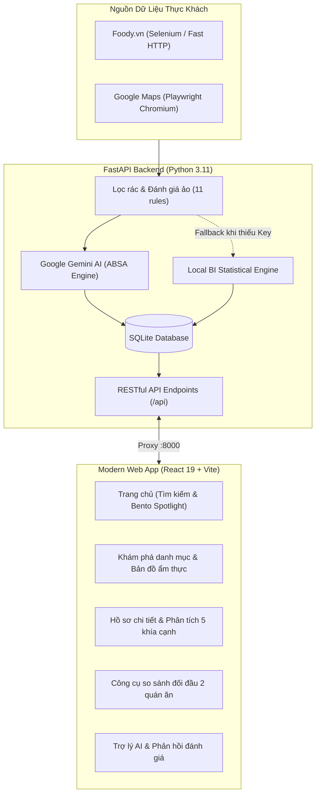

# 🍽️ Restaurant Intelligence (Culinary Lens)

> **Nền tảng phân tích cảm xúc & bóc tách khía cạnh đánh giá ẩm thực đa nguồn (Foody & Google Maps) ứng dụng Trí tuệ Nhân tạo (Google Gemini AI).**

[](https://react.dev/)
[](https://www.typescriptlang.org/)
[](https://vitejs.dev/)
[](https://tailwindcss.com/)
[](https://fastapi.tiangolo.com/)
[](https://www.python.org/)
[](https://aistudio.google.com/)
[](https://www.sqlite.org/)
[](LICENSE)

---

## 📖 Mục Lục
- [Tổng quan dự án](#-tổng-quan-dự-án)
- [Kiến trúc hệ thống](#-kiến-trúc-hệ-thống)
- [Tính năng nổi bật](#-tính-năng-nổi-bật)
- [Yêu cầu hệ thống](#-yêu-cầu-hệ-thống)
- [Khởi chạy nhanh (Quick Start)](#-khởi-chạy-nhanh-quick-start)
- [Cấu hình môi trường (.env)](#-cấu-hình-môi-trường-env)
- [Cấu trúc mã nguồn](#-cấu-trúc-mã-nguồn)
- [Danh mục REST API](#-danh-mục-rest-api)
- [Crawler & Data Pipeline](#-crawler--data-pipeline)
- [Triển khai Production với Docker](#-triển-khai-production-với-docker)
- [Khắc phục sự cố thường gặp (FAQ)](#-khắc-phục-sự-cố-thường-gặp-faq)
- [Giấy phép & Đạo đức dữ liệu](#-giấy-phép--đạo-đức-dữ-liệu)

---

## 🎯 Tổng Quan Dự Án

**Restaurant Intelligence** giải quyết bài toán "bội thực thông tin" khi thực khách phải đọc hàng trăm bình luận rời rạc, lẫn lộn giữa đánh giá thật và đánh giá ảo trước khi quyết định chọn quán ăn. 

Hệ thống tự động:
1. Thu thập dữ liệu đánh giá đa nguồn từ **Foody** và **Google Maps**.
2. Khử nhiễu, loại bỏ bình luận rác và tài khoản ảo bằng thuật toán phân loại 11 quy tắc.
3. Bóc tách cảm xúc theo 5 khía cạnh cốt lõi (Aspect-Based Sentiment Analysis - ABSA) bằng **Google Gemini AI**: **Món ăn**, **Giá cả**, **Dịch vụ**, **Không gian**, và **Vị trí/Vệ sinh**.
4. Cung cấp **Trợ lý AI F&B** giải đáp chi tiết về quán và **Bộ soạn thảo phản hồi đánh giá** tự động giúp chủ quán phản hồi khách hàng chuyên nghiệp.

> [!NOTE]
> **Chế độ Dự phòng Thông minh (Zero-Downtime Fallback)**: Dự án tích hợp sẵn cơ chế **Local BI Engine**. Ngay cả khi chưa cấu hình Gemini API Key hoặc mạng bị gián đoạn, hệ thống vẫn khởi chạy và hiển thị đầy đủ hồ sơ phân tích số liệu dựa trên thuật toán thống kê cục bộ.

---

## 🏛️ Kiến Trúc Hệ Thống



---

## ✨ Tính Năng Nổi Bật

* **Bóc tách 5 khía cạnh cốt lõi (ABSA)**: Trực quan hóa tỷ lệ hài lòng theo từng tiêu chí thay vì chỉ hiển thị một điểm số sao trung bình vô nghĩa.
* **Món nên thử & Điểm cần lưu ý**: Tự động gom cụm món ăn được khen ngợi nhiều nhất (Signature Dish) và các vấn đề hay gặp (chờ món lâu, khó tìm chỗ gửi xe...).
* **Lọc nhận xét minh bạch**: Loại trừ các nhận xét sao chép, spam quảng cáo, tài khoản seeding ảo để giữ độ tin cậy dữ liệu ở mức cao nhất.
* **So sánh đối đầu (Head-to-Head)**: Đặt 2 quán ăn cạnh nhau trên cùng hệ quy chiếu 5 tiêu chí để hỗ trợ ra quyết định nhanh chóng.
* **Trợ lý AI F&B (Ask Assistant)**: Hỏi đáp ngôn ngữ tự nhiên về quán ăn (ví dụ: *"Quán có phù hợp dẫn người yêu đi hẹn hò không?"*, *"Món nào ngon nhất nên gọi?"*).
* **Công cụ soạn thảo phản hồi đánh giá (Review Responder)**: Tự động tạo thư phản hồi khách hàng theo 4 tông giọng: *Chân thành & Cầu thị*, *Chuyên nghiệp & Chuẩn mực*, *Thân mật & Ấm áp*, hoặc *Tri ân kèm Voucher đền bù*.
* **Tự động thu thập định kỳ**: Tích hợp GitHub Actions Workflow định kỳ cào và cập nhật dữ liệu tự động.

---

## 💻 Yêu Cầu Hệ Thống

Trước khi bắt đầu, hãy đảm bảo máy tính của bạn đã cài đặt:
* **Node.js**: Phiên bản `18.x` trở lên (Khuyến nghị `Node.js 20+` hoặc `22+`) & `npm`
* **Python**: Phiên bản `3.10+` (Khuyến nghị `Python 3.11+`) & `pip`
* **Google Chrome**: Cần thiết cho Selenium điều khiển trình duyệt khi cào Foody
* **Git**: Để clone mã nguồn

---

## 🚀 Khởi Chạy Nhanh (Quick Start)

Chỉ mất chưa đầy 3 phút để khởi chạy toàn bộ hệ thống trên máy cá nhân:

### Bước 1: Clone Repository
```bash
git clone https://github.com/ciaotee86/restaurant-intelligence.git
cd restaurant-intelligence
```

### Bước 2: Cài đặt Dependencies Frontend & Backend
```bash
# Cài đặt thư viện Node.js cho Frontend
npm install

# Cài đặt thư viện Python cho Backend
pip install -r restaurant-review-ai/requirements.txt
```

### Bước 3: Cài đặt Playwright Browser (cho Google Maps Crawler)
```bash
python -m playwright install chromium
```

### Bước 4: Thiết lập Biến Môi Trường
Sao chép tệp mẫu `.env.example` thành `.env`:
```bash
# Trên Windows PowerShell:
Copy-Item .env.example .env

# Trên macOS / Linux / Git Bash:
cp .env.example .env
```
*(Tùy chọn)* Mở file `.env` và điền `GEMINI_API_KEY` của bạn nếu muốn trải nghiệm toàn bộ sức mạnh AI (xem hướng dẫn lấy key miễn phí bên dưới).

### Bước 5: Khởi Chạy Hệ Thống
Chạy 1 lệnh duy nhất để khởi động đồng thời cả **Vite Dev Server** và **FastAPI Backend**:
```bash
npm run dev
```

Truy cập ứng dụng tại:
* 🌐 **Giao diện Web App**: [http://localhost:5173](http://localhost:5173)
* 📑 **Tài liệu API Swagger**: [http://localhost:8000/docs](http://localhost:8000/docs)
* 🩺 **Kiểm tra trạng thái hệ thống**: [http://localhost:8000/api/health](http://localhost:8000/api/health)

---

## ⚙️ Cấu Hình Môi Trường (.env)

Hệ thống đọc cấu hình từ file `.env` ở thư mục gốc hoặc trong `restaurant-review-ai/.env`:

| Tên biến | Bắt buộc | Mặc định | Ý nghĩa & Mô tả |
| :--- | :---: | :---: | :--- |
| `GEMINI_API_KEY` | Không | `None` | Khóa API Google Gemini. Nếu để trống, hệ thống tự động kích hoạt **Local BI Fallback**. |
| `PORT` | Không | `8000` | Cổng mạng cho FastAPI Backend Server (`10000` trên Render/Docker). |
| `DATABASE_URL` | Không | `SQLite local` | Chuỗi kết nối Database SQLite (`data/restaurants.db`). |
| `ALLOWED_ORIGINS`| Không | `*` | Danh sách domain được phép gọi CORS trong môi trường production. |

### 🔑 Cách lấy Google Gemini API Key (Hoàn toàn Miễn phí)
1. Truy cập [Google AI Studio](https://aistudio.google.com/apikey).
2. Đăng nhập bằng tài khoản Google bất kỳ.
3. Nhấp vào **"Create API key"** > Chọn **"Create key in new project"**.
4. Sao chép chuỗi khóa (bắt đầu bằng `AIzaSy...`) và dán vào file `.env`:
   ```env
   GEMINI_API_KEY=AIzaSyYourActualKeyHere
   ```

---

## 📂 Cấu Trúc Mã Nguồn

```
restaurant-intelligence/
├── src/                               # [FRONTEND] Mã nguồn React 19 + TypeScript
│   ├── assets/                        # Ảnh tĩnh, icon SVG
│   ├── components/                    # Thành phần giao diện React
│   │   ├── common/                    # SearchBar, Badge, Modal phân tích URL...
│   │   ├── dashboard/                 # AspectAnalysis, ReviewExplorer, AiAssistant...
│   │   ├── layout/                    # Navbar, Footer
│   │   └── restaurant-list/           # RestaurantCard, FilterBar
│   ├── data/                          # Mock fallback data
│   ├── pages/                         # Các trang: HomePage, ExplorePage, DashboardPage, HowItWorksPage
│   ├── services/                      # Client API Service (restaurantService.ts)
│   ├── types/                         # TypeScript interfaces (Restaurant, Review, Aspect...)
│   └── utils/                         # Hàm bổ trợ: xử lý tiếng Việt, định dạng số, lọc cảm xúc
│
├── restaurant-review-ai/              # [BACKEND] Mã nguồn FastAPI + AI + Crawler
│   ├── analysis/                      # Module AI phân tích cảm xúc (gemini_analyzer.py)
│   ├── crawler/                       # Module cào dữ liệu (foody_crawler.py, google_maps_crawler.py)
│   ├── data/                          # SQLite Database chứa dữ liệu nhà hàng thật (restaurants.db)
│   ├── database/                      # Kết nối SQLite & Schema SQLAlchemy (models.py, db.py)
│   ├── routers/                       # FastAPI Route controllers (restaurants.py, crawler.py)
│   ├── services/                      # Nghiệp vụ: bi_service.py, assistant_service.py, reply_service.py
│   ├── api_server.py                  # Entrypoint chính khởi chạy FastAPI Server
│   ├── run_pipeline.py                # Script chạy crawler tự động hàng loạt
│   └── requirements.txt               # Danh sách thư viện Python
│
├── public/                            # Tài nguyên tĩnh công khai (logo, favicon)
├── Dockerfile                         # Cấu hình đóng gói Container 2-stage (Node + Python)
├── .dockerignore                      # Loại trừ file rác khi build Docker
├── .env.example                       # File mẫu cấu hình biến môi trường
├── package.json                       # Scripts & Dependencies Node.js
├── vite.config.ts                     # Cấu hình Vite & API Proxy
└── README.md                          # Tài liệu hướng dẫn sử dụng dự án
```

---

## 📡 Danh Mục REST API

Backend cung cấp đầy đủ chuẩn REST API với tài liệu tương tác tự động tại Swagger UI: `http://localhost:8000/docs`.

### 1. Thông Tin Quán Ăn & Đánh Giá
* **`GET /api/health`**: Kiểm tra trạng thái máy chủ, tình trạng kết nối DB và số lượng bản ghi.
* **`GET /api/restaurants`**: Lấy danh sách quán ăn (hỗ trợ phân trang, lọc theo thành phố `?city=`, tìm kiếm từ khóa `?search=`).
* **`GET /api/restaurants/{id_or_slug}`**: Lấy chi tiết hồ sơ phân tích 5 khía cạnh, món signature và điểm lưu ý của quán.
* **`GET /api/restaurants/{id_or_slug}/reviews`**: Lấy danh sách đánh giá gốc đã được phân loại cảm xúc.

### 2. Tương Tác AI & Trợ Lý Ẩm Thực
* **`POST /api/restaurants/{id_or_slug}/ask`**: Hỏi đáp với Trợ lý AI về quán ăn.
  ```json
  // Request Body
  {
    "question": "Quán này có những món gì ngon nhất và giá cả thế nào?",
    "forceAi": true
  }
  ```
* **`POST /api/restaurants/{id_or_slug}/reply`**: Soạn phản hồi cho đánh giá của khách hàng.
  ```json
  // Request Body
  {
    "review_text": "Đồ ăn rất ngon nhưng quán phục vụ hơi chậm vào giờ trưa.",
    "tone": "sincere", // "sincere" | "professional" | "warm" | "compensatory"
    "reviewer_name": "Minh Khang",
    "voucher_code": "DISCOUNT10"
  }
  ```

### 3. Thu Thập Dữ Liệu (Crawler)
* **`POST /api/crawler/analyze`**: Cào và phân tích trực tiếp một quán ăn mới từ liên kết Foody.
* **`POST /api/crawler/link-google-maps`**: Liên kết và bổ sung đánh giá từ Google Maps cho quán ăn.
* **`POST /api/crawler/search-and-crawl`**: Tìm kiếm từ khóa và tự động cào quán ăn mới.

---

## 🕷️ Crawler & Data Pipeline

Ngoài việc cào dữ liệu qua giao diện Web, bạn có thể thực thi các tác vụ cào dữ liệu độc lập thông qua giao diện dòng lệnh (CLI):

```bash
# 1. Chuyển vào thư mục backend
cd restaurant-review-ai

# 2. Cào danh sách quán theo cấu hình pipeline tự động
python run_pipeline.py

# 3. Hoặc cào các quán chỉ định cụ thể trong main.py
python main.py
```

---

## 🐳 Triển Khai Production với Docker

Dự án đã được tối ưu hóa với **Multi-Stage Dockerfile** (kết hợp Node.js builder và Python 3.11 Slim runtime có sẵn Chromium Headless):

```bash
# 1. Đóng gói Docker Image
docker build -t restaurant-intelligence:latest .

# 2. Khởi chạy Container
docker run -d -p 8000:8000 \
  -e GEMINI_API_KEY="your_api_key_here" \
  -v $(pwd)/restaurant-review-ai/data:/app/data \
  --name restaurant-app \
  restaurant-intelligence:latest
```

Ứng dụng sẽ tự động phục vụ cả giao diện Web tĩnh React và toàn bộ API backend tại cổng `http://localhost:8000`.

---

## 🛠️ Khắc Phục Sự Cố Thường Gặp (FAQ)

### Q1: Gặp lỗi `Address already in use` hoặc lỗi cổng 8000?
> **Giải pháp**: Hệ thống đã tích hợp sẵn cơ chế **Port Guard** (`_ensure_port_available`). Nếu một tiến trình Python cũ bị treo chiếm cổng 8000, server sẽ tự động thu hồi và giải phóng cổng khi khởi động lại. Bạn cũng có thể đổi cổng bằng cách chỉnh `PORT=8080` trong file `.env`.

### Q2: Tôi không có Gemini API Key thì có dùng được ứng dụng không?
> **Giải pháp**: **Hoàn toàn được!** Khi không phát hiện API Key, hệ thống tự động kích hoạt **Local BI Fallback Engine**. Tất cả các biểu đồ khía cạnh, danh sách quán ăn, số liệu thống kê và tìm kiếm đều hoạt động trơn tru 100% dựa trên thuật toán phân tích cục bộ.

### Q3: Lỗi `playwright._impl._errors.Error: Executable doesn't exist at ...` khi cào Google Maps?
> **Giải pháp**: Bạn chỉ cần chạy lệnh sau một lần duy nhất để tải Chromium:
> ```bash
> python -m playwright install chromium
> ```

### Q4: Lỗi `WebDriverException: Message: 'chromedriver' executable needs to be in PATH` khi cào Foody?
> **Giải pháp**: Đảm bảo máy tính của bạn đã cài đặt trình duyệt **Google Chrome**. Thư viện `webdriver-manager` sẽ tự động tải phiên bản ChromeDriver phù hợp mà bạn không cần phải copy thủ công.

---

## 📄 Giấy Phép & Đạo Đức Dữ Liệu

* **Mã nguồn**: Phát hành theo giấy phép [MIT License](LICENSE). Tự do sử dụng, chỉnh sửa và phân phối cho mục đích học tập và nghiên cứu.
* **Dữ liệu**: Dữ liệu đánh giá thuộc bản quyền của người dùng và các nền tảng gốc (Foody, Google Maps). Bộ cào dữ liệu được xây dựng với cơ chế rate-limiting, thời gian chờ hợp lý nhằm tôn trọng tài nguyên máy chủ và chỉ phục vụ mục đích nghiên cứu học thuật phi thương mại.

---

<p align="center">
  Được phát triển với tinh thần <b>Kỹ nghệ Phần mềm Độc lập</b> & <b>Trí tuệ Nhân tạo Ứng dụng</b>. <br />
  Nếu dự án hữu ích cho bạn, hãy tặng một ⭐️ trên GitHub nhé!
</p>
