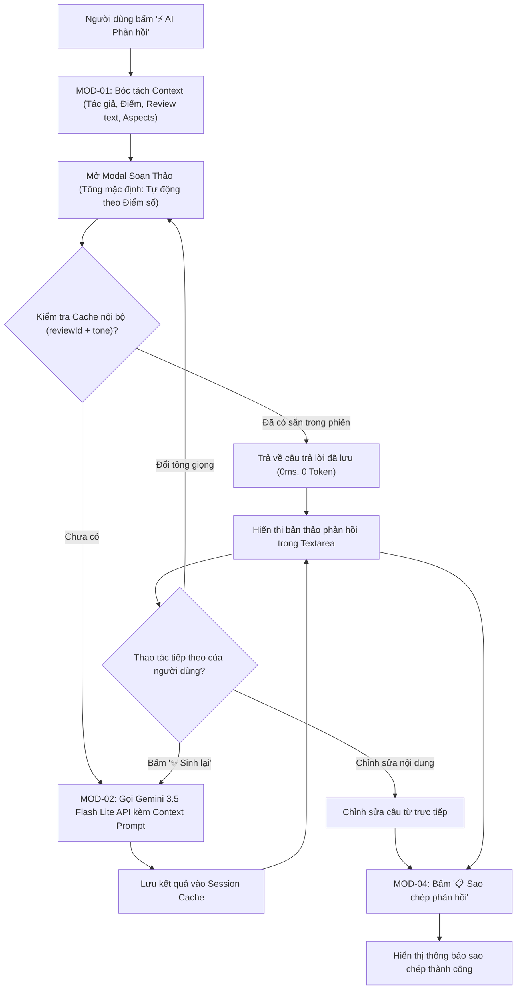

# ĐẶC TẢ TÍNH NĂNG: AI SOẠN THƯ PHẢN HỒI THỰC KHÁCH (AI REVIEW RESPONDER)
## Phân Rã Chức Năng, Hợp Đồng Dữ Liệu Input/Output, Lộ Trình Triển Khai & Định Hướng Phát Triển

> **Mã tài liệu**: `SPEC-FEAT-05`  
> **Phiên bản áp dụng**: v1.13.0  
> **Kiến trúc mô hình**: Pure Generative AI Engine (Gemini LLM-First)  
> **Trạng thái**: Bản thảo đặc tả kỹ thuật (Draft Specification - Đã cập nhật theo phản hồi)  
> **Dự án**: Restaurant Intelligence System  

---

## 1. Tổng Quan & Bài Toán Nghiệp Vụ (Problem Statement)

* **Thực trạng**: Các bảng điều khiển phân tích ẩm thực (BI Dashboard) hiện tại chỉ dừng ở việc thống kê số liệu thụ động. Khi đối mặt với các đánh giá tiêu cực (1-2 sao) hoặc phản hồi phức tạp từ thực khách, chủ quán và nhân viên quản lý thường bối rối, tốn nhiều thời gian suy nghĩ câu từ hoặc phản hồi thiếu khéo léo, dễ bùng phát khủng hoảng truyền thông.
* **Mục tiêu**: Bổ sung tính năng **AI Review Responder (Closed-Loop Action)** ứng dụng trực tiếp mô hình ngôn ngữ lớn (**Google Gemini AI**). Chỉ với 1 cú click chuột, AI sẽ thấu hiểu sâu sắc ngữ cảnh bài đánh giá (người viết, khuyết điểm cụ thể bị chê, điểm khen, thái độ) để tự động chấp bút bức thư phản hồi chuẩn mực, đầy thấu cảm, đa dạng 4 tông giọng theo chuẩn mực ngành dịch vụ F&B.
* **Định vị Đồ án AI**: Tính năng này khẳng định giá trị cốt lõi của một hệ thống ứng dụng AI thực thụ — sử dụng Generative AI để tự động hóa nghiệp vụ chăm sóc khách hàng (Customer Care CRM), thay vì sử dụng các mẫu câu ghép tĩnh đơn thuần.

---

## 2. Phân Rã Chức Năng (Functional Decomposition)

Hệ thống tính năng được phân rã thành **4 phân hệ chính** với tổng cộng **12 chức năng nguyên tử (Atomic Functions)** được thiết kế xoay quanh mô hình AI:

```
HỆ THỐNG AI REVIEW RESPONDER (GEMINI LLM-FIRST)
├── [MOD-01] Thu Thập & Chuẩn Hóa Ngữ Cảnh Đánh Giá (Review Context Ingestion)
│   ├── F1.1: Bóc tách thực thể định danh (Tên khách, Ngày đăng, Điểm sao, Tên quán)
│   ├── F1.2: Trích xuất danh sách khía cạnh ABSA đã gắn nhãn (Món ăn, Dịch vụ, Giá cả, Vệ sinh)
│   └── F1.3: Đo lường mức độ khẩn cấp & cảm xúc gốc (Sentiment Intensity & Crisis Flag)
├── [MOD-02] Động Cơ Soạn Thảo Generative AI (Gemini Prompt & Inference Engine)
│   ├── F2.1: Kỹ nghệ Prompt chuyên gia F&B (Few-Shot Contextual Prompt Injection)
│   ├── F2.2: Điều phối suy luận Gemini LLM (Ưu tiên Gemini 3.5 Flash Lite / Model Cascading)
│   ├── F2.3: Điều hướng văn phong theo 4 tông giọng nghiệp vụ (Tone Conditioning)
│   └── F2.4: Bộ nhớ đệm ngữ nghĩa thông minh (In-Memory Response Caching theo Review ID & Tone)
├── [MOD-03] Tùy Biến 4 Tông Giọng & Bộ Công Cụ Biên Tập (Tone Selection & In-Place Editing)
│   ├── F3.1: Bộ chuyển mạch 4 tông giọng tương tác (Nhận lỗi, Voucher đền bù, Tri ân, Giải thích)
│   ├── F3.2: Bộ cấp phát mã ưu đãi tượng trưng tự động lồng ghép ({VOUCHER_CODE})
│   └── F3.3: Trình hiệu chỉnh nội dung trực tiếp (Live In-Place Text Editor)
└── [MOD-04] Tương Tác Giao Diện & Trải Nghiệm Khép Kín (Actionable UI/UX Toolkit)
    ├── F4.1: Nút kích hoạt nhanh `⚡ AI Phản hồi` trên từng thẻ đánh giá (`ReviewExplorer` & `ReviewDetailModal`)
    ├── F4.2: Hộp thoại soạn thảo chuẩn tạp chí Warm Gastronomy kèm Skeleton Loading (`ReviewReplyModal`)
    └── F4.3: Nút tái tạo câu trả lời (`✨ Sinh lại`) & Sao chép 1 chạm vào Clipboard
```

---

## 3. Kiến Trúc Luồng Dữ Liệu (Architecture & Data Flow)

Toàn bộ quy trình sinh lời văn phản hồi được dẫn dắt trực tiếp bởi Gemini AI kết hợp bộ nhớ đệm đắc lực để tối ưu độ trễ:



---

## 4. Đặc Tả Hợp Đồng Dữ Liệu (Input / Output Specification)

### 4.1. Dữ Liệu Đầu Vào (Input Contract)

* **Endpoint**: `POST /api/restaurants/{id}/generate-reply`
* **Content-Type**: `application/json`

```typescript
export interface GenerateReplyRequest {
  restaurantId: string;                     // ID hoặc slug định danh quán ăn
  restaurantName: string;                   // Tên nhà hàng (để AI đại diện xưng hô)
  reviewId: string;                         // Mã định danh của review gốc
  author: string;                           // Tên thực khách đăng bài
  rating: number;                           // Điểm số review (1.0 - 10.0 hoặc 1 - 5 sao)
  overallSentiment: 'positive' | 'neutral' | 'negative';
  reviewText: string;                       // Toàn văn nhận xét gốc của khách hàng
  aspects?: Array<{                         // Các khía cạnh ABSA đã gắn nhãn
    aspect: 'Món ăn' | 'Dịch vụ' | 'Giá cả' | 'Không gian' | 'Vị trí';
    sentiment: 'positive' | 'neutral' | 'negative';
  }>;
  tone: 'apology' | 'voucher' | 'gratitude' | 'clarification'; // 1 trong 4 tông giọng
  includeVoucher?: boolean;                 // Có kích hoạt tạo voucher đền bù không
  voucherDiscountPercent?: number;          // Tỷ lệ % ưu đãi (mặc định: 15 hoặc 20%)
}
```

### 4.2. Dữ Liệu Đầu Ra (Output Contract)

* **HTTP Status**: `200 OK`

```typescript
export interface GenerateReplyResponse {
  replyText: string;                        // Bức thư hoàn chỉnh do Gemini AI sáng tạo
  toneUsed: 'apology' | 'voucher' | 'gratitude' | 'clarification';
  engineUsed: 'gemini_ai' | 'gemini_cache'; // Minh bạch mô hình AI xử lý
  responseTimeMs: number;                   // Thời gian suy luận của AI (vd: 650ms)
  generatedVoucherCode?: string;            // Mã voucher do hệ thống cấp (vd: 'CARE-BAMUA-20')
  aspectsAddressed: string[];               // Danh sách các khía cạnh AI đã đề cập xử lý
  modelName: string;                        // Model AI thực tế (vd: 'gemini-3.5-flash-lite')
}
```

### 4.3. Định Nghĩa 4 Tông Giọng Phản Hồi Dành Cho Gemini Prompt

Mỗi tông giọng được cấu trúc bằng một bộ **System Instruction** chặt chẽ để hướng dẫn Gemini:

| Mã tông | Tên hiển thị | Ngữ cảnh ứng dụng | Kim chỉ nam cho Gemini Prompt (AI Guardrails) |
| :--- | :--- | :--- | :--- |
| `apology` | **Chân thành & Nhận lỗi** | Khách chê gắt gao (1-2 sao) về phục vụ, đồ ăn dở, thái độ nhân viên | Xưng hô lịch thiệp, nhận trách nhiệm thẳng thắn, tuyệt đối không bao biện, không đổ lỗi cho hoàn cảnh; cam kết đào tạo lại nhân sự/chấn chỉnh bếp; để lại hotline hỗ trợ trực tiếp. |
| `voucher` | **Lịch sự & Tặng Voucher** | Sự cố món ăn bị nguội, thời gian chờ lâu, nhầm món | Bày tỏ sự nuối tiếc vì trải nghiệm chưa trọn vẹn, khéo léo gửi tặng mã giảm giá ưu đãi {VOUCHER_CODE} cho lần ghé thăm tiếp theo nhằm giữ chân khách hàng. |
| `gratitude` | **Tri ân & Thân thiện** | Đánh giá 4-5 sao khen ngợi hương vị, không gian quán | Lời cảm ơn ấm áp, nhắc lại món ăn mà khách đã khen, tạo cảm giác thân tình như người quen, khuyến khích khách rủ bạn bè/gia đình quay lại. |
| `clarification` | **Giải thích & Cầu thị** | Hiểu lầm về kích cỡ phần ăn, giờ cao điểm, chính sách giá | Trình bày lịch sự, minh bạch về tiêu chuẩn định lượng hoặc lý do khách quan, tôn trọng cảm nhận của khách và khẳng định luôn lắng nghe để cải tiến. |

---

## 5. Lộ Trình Triển Khai (Roadmap & Implementation Plan)

### 5.1. Bảng Kế Hoạch Cấp Cao (High-Level Roadmap)

| Phase | Tên giai đoạn | Thời gian | Mục tiêu cốt lõi | Sản phẩm bàn giao |
| :---: | :--- | :---: | :--- | :--- |
| **P1** | **Backend Gemini AI Service** | 1 buổi | Xây dựng Prompt Engine & kết nối Gemini 3.5 Flash Lite | `reply_service.py`, endpoint `/api/restaurants/{id}/reply`, cache ngữ nghĩa |
| **P2** | **Frontend Warm Gastronomy UI** | 1 buổi | Modal phản hồi, bộ chọn tông giọng & Skeleton AI | `ReviewReplyModal.tsx`, tích hợp nút trên `ReviewExplorer.tsx` |
| **P3** | **Kiểm Thử & Đóng Gói Hoàn Thiện** | 0.5 buổi | Kiểm thử 4 tông giọng, clipboard copy, stress-test API | Test suite tự động, cập nhật CHANGELOG `v1.13.0` |

---

### 5.2. Danh Mục Công Việc Chi Tiết (Detailed Task Breakdown)

- [ ] **[TASK-01] Xây dựng Backend Gemini Reply Service & Prompt Engine** (2h)
  - **Module/Files**: `restaurant-review-ai/services/reply_service.py`
  - **Dependencies**: Tận dụng Google GenAI SDK hiện có trong project.
  - **Chi tiết**:
    - Thiết kế bộ prompt template tối ưu văn phong ẩm thực Việt Nam theo 4 tông giọng.
    - Truyền trực tiếp dữ liệu context: `{author}`, `{restaurant_name}`, `{review_text}`, `{aspects}`, `{rating}` vào System Instruction.
    - Kết nối Gemini 3.5 Flash Lite với cơ chế model cascading fallback (`gemini-3.5-flash-lite` $\rightarrow$ `gemini-2.5-flash`).
    - Tích hợp Session Cache trong bộ nhớ: Nếu người dùng chuyển qua lại giữa các tông giọng đã sinh trước đó, lấy ngay từ cache mà không gọi trùng lặp API.
  - **DoD / Acceptance Criteria**:
    - Phản hồi từ Gemini hoàn tất trong $< 1.8\text{s}$.
    - Văn phong chuẩn tiếng Việt, tự nhiên, không bị cụt lủn hay lặp từ.

- [ ] **[TASK-02] Đăng Ký Endpoint API Router** (1h)
  - **Module/Files**: `restaurant-review-ai/routers/restaurants.py`
  - **Dependencies**: TASK-01.
  - **Chi tiết**:
    - Khai báo schema Pydantic `GenerateReplyRequest` và `GenerateReplyResponse`.
    - Tạo route `POST /api/restaurants/{id}/reply`.
    - Đảm bảo tương thích cả chuẩn `camelCase` (frontend) lẫn `snake_case` (backend).
  - **DoD / Acceptance Criteria**:
    - Gọi thử nghiệm qua FastAPI Swagger `/docs` trả về mã 200 kèm phản hồi AI hoàn chỉnh.

- [ ] **[TASK-03] Xây Dựng Component Modal Phản Hồi (ReviewReplyModal)** (3h)
  - **Module/Files**: `src/components/dashboard/ReviewReplyModal.tsx`
  - **Dependencies**: TASK-02.
  - **Chi tiết**:
    - Thiết kế giao diện Warm Gastronomy sang trọng: Phông `Spectral` cho tiêu đề, `Be Vietnam Pro` cho nội dung.
    - Thanh điều hướng 4 tông giọng với icon và màu sắc trực quan.
    - Hiệu ứng Skeleton Loading / Shimmer tinh tế trong lúc AI đang suy luận.
    - Khung soạn thảo `textarea` cho phép người dùng tự do gõ sửa bổ sung câu chữ.
    - Bộ công cụ hành động: Nút `✨ Sinh lại với AI` và nút `📋 Sao chép phản hồi` (kèm hiệu ứng tích xanh và Toast notification).
  - **DoD / Acceptance Criteria**:
    - Đóng mở mượt mà bằng phím `ESC` hoặc click vùng nền.
    - Responsive 100% trên cả điện thoại và màn hình máy tính.

- [ ] **[TASK-04] Tích Hợp Vào ReviewExplorer & ReviewDetailModal** (1.5h)
  - **Module/Files**: `src/components/dashboard/ReviewExplorer.tsx`, `src/components/dashboard/ReviewDetailModal.tsx`, `src/services/restaurantService.ts`
  - **Dependencies**: TASK-03.
  - **Chi tiết**:
    - Đặt nút `⚡ AI Phản hồi` khéo léo cạnh nút phóng to chi tiết ở từng thẻ review.
    - Khi bấm, tự động xác định tông giọng khởi đầu phù hợp (Review $\le 2$ sao tự động chọn tông *Chân thành nhận lỗi*; Review $\ge 4$ sao tự động chọn tông *Tri ân*).
    - Kết nối hàm gọi API `restaurantService.generateReviewReply()`.
  - **DoD / Acceptance Criteria**:
    - Mọi thẻ đánh giá trong danh sách đều mở được modal tương ứng với đúng dữ liệu của khách đó.

- [ ] **[TASK-05] Kiểm Thử Toàn Diện & Hoàn Thiện Bàn Giao** (1.5h)
  - **Module/Files**: `restaurant-review-ai/tests/test_reply_service.py`, `CHANGELOG.md`
  - **Dependencies**: TASK-01, TASK-02, TASK-04.
  - **Chi tiết**:
    - Viết test suite tự động kiểm tra endpoint và service sinh phản hồi AI.
    - Kiểm tra linter `oxlint` không phát sinh lỗi hoặc warning.
    - Kiểm tra lệnh biên dịch frontend `npm run build` thành công.
    - Cập nhật tài liệu phiên bản trong `CHANGELOG.md`.
  - **DoD / Acceptance Criteria**:
    - 100% pytest test cases pass.
    - Không có bất kỳ lỗi console hay cảnh báo TypeScript nào.

---

### 5.3. Tiêu Chí Nghiệm Thu (Definition of Done)

1. **Chuẩn Mực Trí Tuệ Nhân Tạo**: 100% phản hồi được kiến tạo bởi mô hình Gemini AI, cá nhân hóa sâu sắc theo tên khách và đúng từng chi tiết món ăn / phục vụ bị phàn nàn.
2. **Tốc Độ & Trải Nghiệm**: Thời gian phản hồi lần đầu của Gemini $< 1.8\text{s}$; các lần bấm lại tab cũ trả về ngay lập tức ($0\text{ms}$) nhờ cache.
3. **Tiện Ích 1 Chạm**: Nút copy sao chép chính xác nội dung đang hiển thị trong textarea vào Clipboard máy tính.

---

## 6. Định Hướng Phát Triển Tương Lai (Future Vision)

1. **Tự Động Đăng Trả Lời Qua Webhooks (Direct Platform Integration)**: Kết nối API Google My Business & Foody Partner để gửi phản hồi trực tiếp chỉ bằng 1 nút bấm trên web.
2. **Học Phong Cách Thương Hiệu (Brand Voice Customization)**: Cho phép chủ quán cấu hình văn phong riêng (trẻ trung, dí dỏm hay trang trọng chuẩn Michelin).
3. **Theo Dõi Hiệu Quả Xoa Dịu (Review Recovery Analytics)**: Đo lường tỷ lệ khách hàng quay lại sửa đánh giá sau khi nhận được thư phản hồi từ AI.
