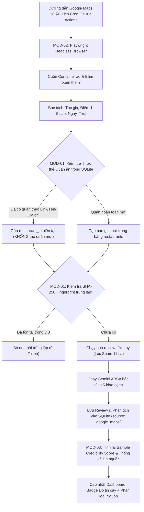

# ĐẶC TẢ KỸ THUẬT: MỞ RỘNG ĐA NGUỒN GOOGLE MAPS, KHỚP NỐI THỰC THỂ & THƯỚC ĐO ĐỘ TIN CẬY
## Multi-Source Data Ingestion, Entity Resolution & Statistical Sample Credibility Spec

> **Mã tài liệu**: `SPEC-FEAT-06`  
> **Phiên bản áp dụng**: v1.14.0  
> **Trạng thái**: Bản thảo đặc tả kỹ thuật (Draft Technical Specification)  
> **Dự án**: Restaurant Intelligence System  

---

## 1. Tổng Quan & Bối Cảnh Nghiệp Vụ (Context & Objectives)

* **Vấn đề cốt tử**: Nền tảng Foody hiện nay tại Việt Nam đã thoái trào, phần lớn thực khách chỉ đánh giá trên Google Maps và các ứng dụng giao hàng. Các quán ăn mới (hoặc quán vừa mở sau năm 2021) trên Foody chỉ có từ 0 đến 3 bài đánh giá, gây ra hiện tượng **thiếu hụt dữ liệu (Data Sparsity)**: biểu đồ xu hướng bị trống, điểm số phân tích ABSA thiếu tính đại diện.
* **Mục tiêu kỹ thuật**:
  1. **Mở rộng nguồn sang Google Maps (Hướng 1)**: Xây dựng module tự động thu thập từ 30-50 đánh giá thực tế/quán từ Google Maps bằng Playwright Headless.
  2. **Giải quyết bài toán khớp thực thể (Entity Resolution)**: Đảm bảo 1 quán ăn duy nhất trong SQLite (`restaurants`), không bị sinh ra các đối tượng quán trùng lặp.
  3. **Khử trùng lặp đánh giá (Deduplication)**: Sử dụng mã băm `fingerprint` (SHA-256) để phát hiện và loại bỏ các bài viết bị sao chép giữa Foody và Google Maps.
  4. **Thước đo độ tin cậy mẫu (Hướng 3 - Statistical Sample Confidence)**: Hiển thị minh bạch chỉ số tin cậy mẫu (dựa trên cỡ mẫu $N$ và độ phân tán), tự động cảnh báo khi quán có quá ít đánh giá.
  5. **Tự động hóa trên Cloud (GitHub Actions DataOps)**: Tận dụng GitHub Actions để tự động kích hoạt cào ngầm, đổi dải IP Data Center, tự phân tích Gemini ABSA và commit SQLite database.

---

## 2. Phân Rã Chức Năng (Functional Decomposition)

Hệ thống được phân rã thành **4 phân hệ chính** với tổng cộng **13 chức năng nguyên tử (Atomic Functions)**:

```
HỆ THỐNG MỞ RỘNG ĐA NGUỒN & ĐỘ TIN CẬY DỮ LIỆU
├── [MOD-01] Nâng Cấp Schema & Khớp Nối Thực Thể (Entity Resolution & Schema)
│   ├── F1.1: Migration mở rộng bảng `restaurants` (`google_maps_url`, `place_id`, `credibility_score`)
│   ├── F1.2: Mở rộng bảng `reviews` với trường nhận diện nguồn (`source = 'foody' | 'google_maps'`)
│   ├── F1.3: Thuật toán so khớp kép thực thể (Fuzzy Name Token Matching + Address Verification)
│   └── F1.4: Lớp khử trùng lặp nội dung review qua mã băm SHA-256 (`fingerprint`)
├── [MOD-02] Động Cơ Thu Thập Dữ Liệu Google Maps (Playwright Headless Crawler)
│   ├── F2.1: Bộ chuẩn hóa và bóc tách định danh URL Google Maps (Canonical URL / Place ID)
│   ├── F2.2: Trình cuộn container ảo (Virtual Infinite Scroll Engine trên `.m6QErb`)
│   ├── F2.3: Bộ mở rộng văn bản ẩn (Auto-click 'Xem thêm' / 'More' buttons)
│   └── F2.4: Bóc tách & chuẩn hóa dữ liệu đánh giá (Tác giả, Số sao 1-5, Ngày tháng, Nội dung)
├── [MOD-03] Thước Đo Độ Tin Cậy & Giao Diện Thích Ứng (Statistical Credibility & Adaptive UI)
│   ├── F3.1: Thuật toán tính toán chỉ số độ tin cậy mẫu (Sample Credibility Index %)
│   ├── F3.2: Huy hiệu cảnh báo cỡ mẫu và độ tin cậy dữ liệu trên Dashboard
│   └── F3.3: Bộ lọc đa chiều theo nguồn đánh giá trên `ReviewExplorer` (Tất cả / Foody / Google Maps)
└── [MOD-04] Tự Động Hóa CI/CD Trên Cloud (GitHub Actions DataOps Pipeline)
    ├── F4.1: Bộ quét tự động các quán có dữ liệu mỏng (< 10 review) cần bù đắp
    └── F4.2: Tự động chạy pipeline Playwright + Gemini ABSA + Git Commit Push trên GitHub Actions
```

---

## 3. Kiến Trúc Luồng Dữ Liệu Đa Nguồn (Architecture & Data Flow)



---

## 4. Đặc Tả Thay Đổi Dữ Liệu (Data Model & Schema Evolution)

### 4.1. Nâng Cấp Bảng `restaurants`
* Bỏ ràng buộc `foody_url` bắt buộc (`nullable=True`), thêm hỗ trợ đa nguồn:
```python
# models.py
class Restaurant(Base):
    __tablename__ = "restaurants"

    id = Column(Integer, primary_key=True, autoincrement=True)
    name = Column(String(255), nullable=False)
    foody_url = Column(String(500), unique=True, nullable=True)        # Cho phép null nếu quán chỉ có link Google Maps
    google_maps_url = Column(String(1000), unique=True, nullable=True) # Link định danh Google Maps
    google_place_id = Column(String(255), index=True, nullable=True)   # Mã Place ID độc nhất của Google
    address = Column(String(500))
    city = Column(String(100))
    overall_rating = Column(Float)
    review_count = Column(Integer, default=0)
    foody_review_count = Column(Integer, default=0)
    google_review_count = Column(Integer, default=0)
    credibility_score = Column(Float, default=1.0)                     # Chỉ số độ tin cậy mẫu (0.0 -> 1.0)
    crawled_at = Column(DateTime, default=datetime.utcnow)
```

### 4.2. Nâng Cấp Bảng `reviews`
* Thêm trường định danh nguồn gốc bài đánh giá:
```python
# models.py
class Review(Base):
    __tablename__ = "reviews"

    # ... các trường hiện tại giữ nguyên ...
    source = Column(String(50), default="Foody")                        # 'Foody' | 'GoogleMaps'
    google_review_id = Column(String(255), index=True, nullable=True)  # ID bài đánh giá trên Google (nếu có)
```

---

## 5. Thuật Toán Tính Toán Độ Tin Cậy Cỡ Mẫu (Statistical Credibility Metric)

Để giải quyết triệt để **Hướng 3**, điểm độ tin cậy mẫu $C$ (từ $0\%$ đến $100\%$) được tính theo quy chuẩn kích thước mẫu tiệm cận:

$$C = \min\left(1.0, \frac{\ln(N + 1)}{\ln(31)}\right) \times 100\%$$

* **Ngưỡng phân loại**:
  * $N \ge 30$ review: $C \ge 95\%$ $\rightarrow$ **Độ tin cậy Cao (Xanh lá)**: Mẫu đủ lớn, phân tích xu hướng có giá trị thống kê cao.
  * $10 \le N < 30$ review: $65\% \le C < 95\%$ $\rightarrow$ **Độ tin cậy Trung bình (Vàng)**: Dữ liệu tham khảo tốt, khuyến khích thu thập thêm.
  * $N < 10$ review: $C < 65\%$ $\rightarrow$ **Độ tin cậy Thấp / Mẫu nhỏ (Cam/Đỏ)**: Hiển thị cảnh báo mẫu nhỏ, khuyến nghị người dùng bấm liên kết nguồn Google Maps để bù đắp dữ liệu.

---

## 6. Hợp Đồng API Mới (API Contracts)

### 6.1. Endpoint Đồng Bộ Nguồn Google Maps
* **Route**: `POST /api/crawler/google-maps`
* **Request Payload**:
```typescript
export interface CrawlGoogleMapsRequest {
  restaurantId?: string;       // ID quán đang có trong DB (nếu muốn bổ sung review vào đúng quán này)
  googleMapsUrl?: string;      // Link Google Maps trực tiếp
  queryName?: string;          // Tên quán muốn tìm kiếm tự động
  maxReviews?: number;         // Giới hạn số review cào (mặc định: 30)
}
```
* **Response Payload**:
```typescript
export interface CrawlGoogleMapsResponse {
  success: boolean;
  restaurantId: string;
  restaurantName: string;
  source: 'google_maps';
  newReviewsCount: number;
  duplicateReviewsSkipped: number;
  totalReviewsNow: number;
  credibilityScore: number;    // Điểm độ tin cậy mới sau khi nạp thêm dữ liệu
  elapsedSeconds: number;
}
```
