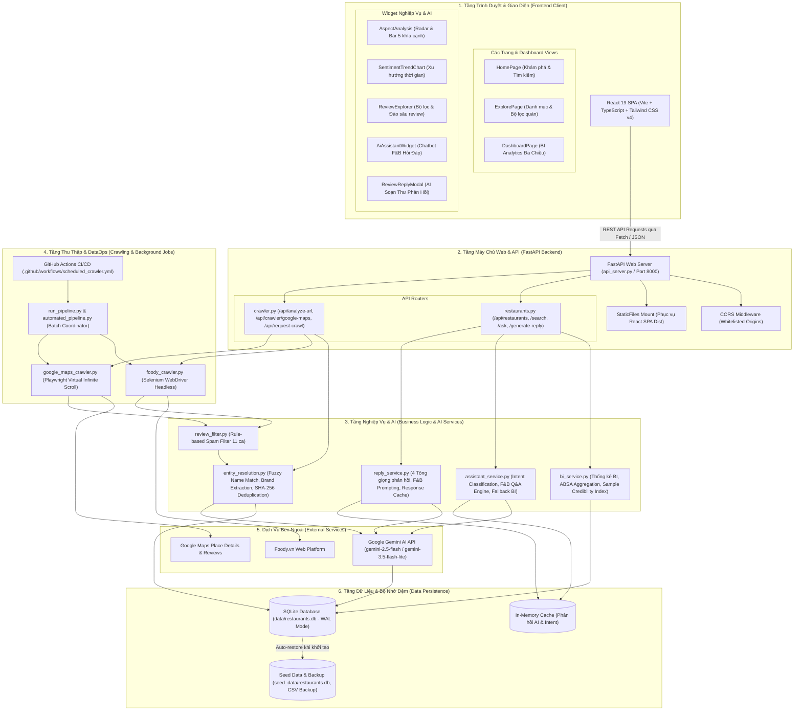
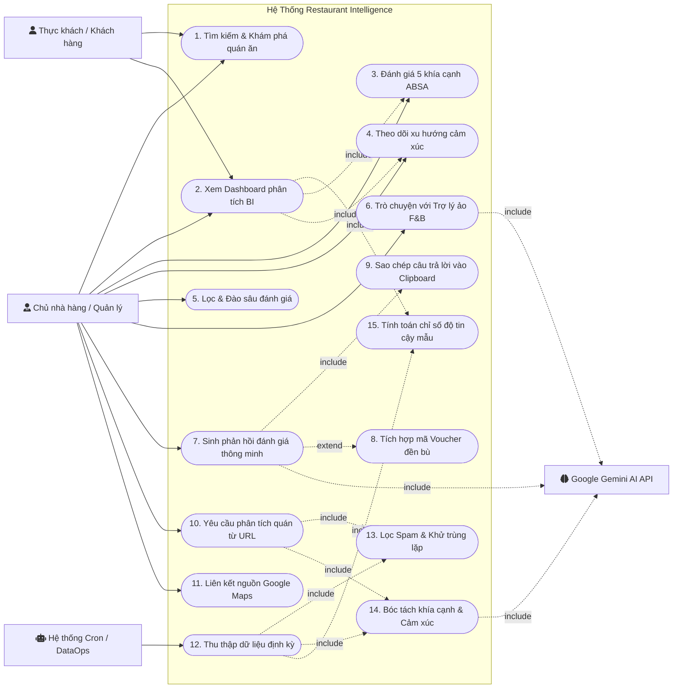
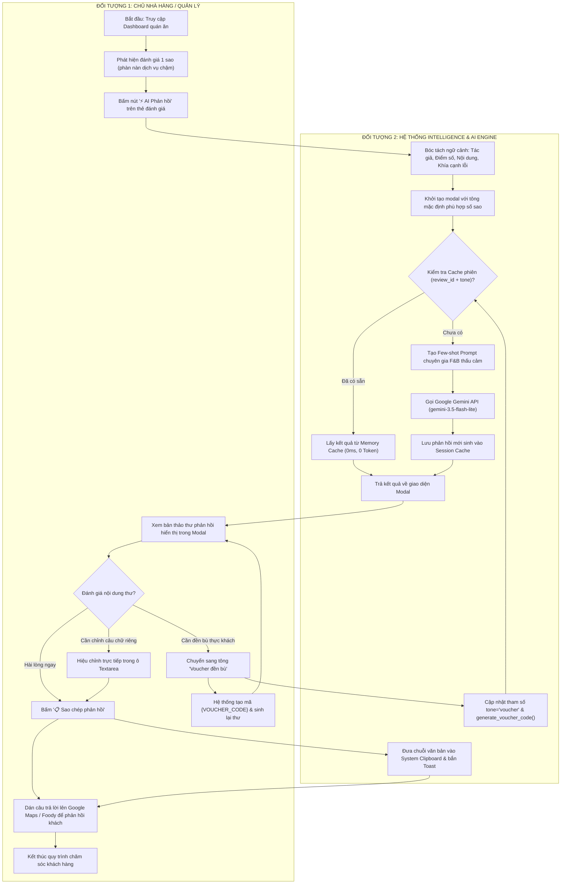
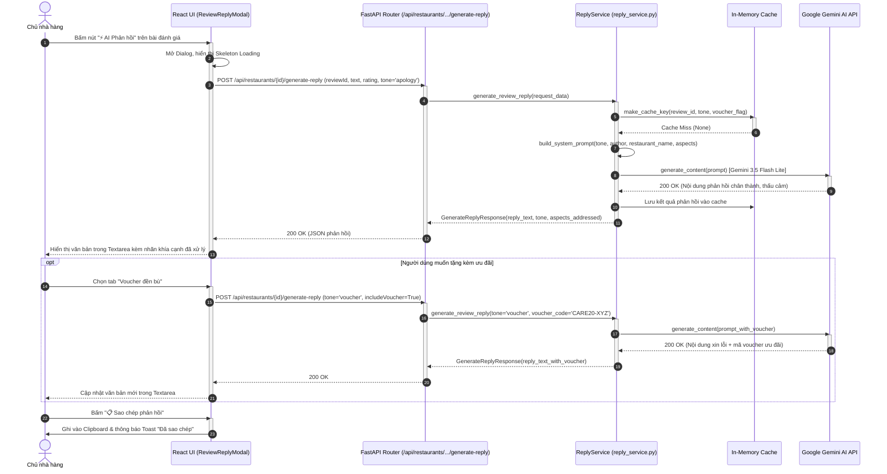
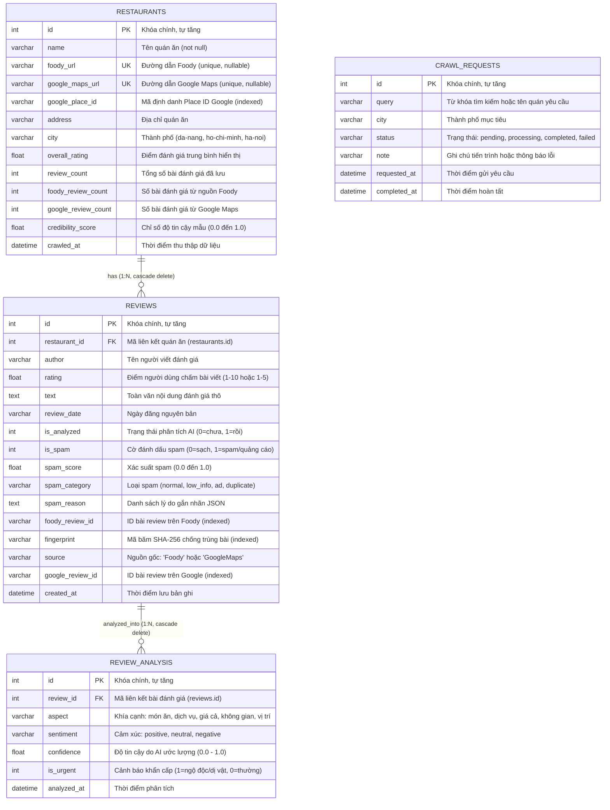
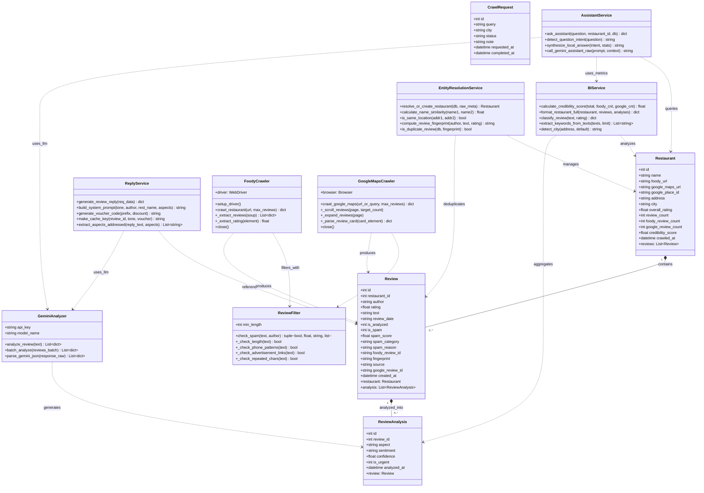

# BỘ SƠ ĐỒ THIẾT KẾ KIẾN TRÚC & HỆ THỐNG
## Dự án: Restaurant Intelligence System (Phân Tích Đánh Giá Nhà Hàng Đa Nguồn & AI Phản Hồi)

> **Mã tài liệu**: `DOC-ARCH-08`  
> **Phiên bản hệ thống**: v1.14.0  
> **Công nghệ chính**: React 19 + TypeScript + Vite + Tailwind CSS + FastAPI + SQLAlchemy + SQLite (WAL) + Selenium/Playwright + Google Gemini AI  
> **Ngày cập nhật**: 25/10/2026  

---

## MỤC LỤC
1. [Sơ đồ 1: Kiến Trúc Hệ Thống (System Architecture Diagram)](#1-sơ-đồ-kiến-trúc-hệ-thống-system-architecture)
2. [Sơ đồ 2: Sơ đồ Use Case (Use Case Diagram)](#2-sơ-đồ-use-case-use-case-diagram)
3. [Sơ đồ 3: Sơ đồ Luồng Hoạt Động Của 2 Đối Tượng (Activity Diagram / Swimlane)](#3-sơ-đồ-luồng-hoạt-động-của-2-đối-tượng-activity-diagram--swimlane)
4. [Sơ đồ 4: Sơ đồ Tuần Tự (Sequence Diagram)](#4-sơ-đồ-tuần-tự-sequence-diagram)
5. [Sơ đồ 5: Sơ đồ Thực Thể Liên Kết (Entity-Relationship Diagram - ERD)](#5-sơ-đồ-thực-thể-liên-kết-erd)
6. [Sơ đồ 6: Sơ đồ Luồng Dữ Liệu (Data Flow Diagram - DFD Level 1)](#6-sơ-đồ-luồng-dữ-liệu-data-flow-diagram---dfd-level-1)
7. [Sơ đồ 7: Sơ đồ Lớp (Class Diagram)](#7-sơ-đồ-lớp-class-diagram)

---

## 1. Sơ đồ Kiến Trúc Hệ Thống (System Architecture)

Sơ đồ mô tả cấu trúc phân tầng (Layered Architecture) hoàn chỉnh của hệ thống từ tầng Trình duyệt Client, tầng Web API Server, tầng Nghiệp vụ & AI, tầng Thu thập Dữ liệu (Crawling/DataOps) đến tầng Cơ sở dữ liệu SQLite.



---

## 2. Sơ đồ Use Case (Use Case Diagram)

Sơ đồ thể hiện đầy đủ các trường hợp sử dụng (Use Cases) của 3 nhóm tác nhân chính: **Chủ nhà hàng / Quản lý**, **Thực khách / Người dùng**, và **Hệ thống tự động (DataOps Scheduler)**, cùng mối quan hệ phụ thuộc (`<<include>>`, `<<extend>>`) với dịch vụ bên ngoài **Google Gemini AI**.



---

## 3. Sơ đồ Luồng Hoạt Động Của 2 Đối Tượng (Activity Diagram / Swimlane)

Sơ đồ luồng phân làn giữa **Chủ nhà hàng (Actor)** và **Hệ thống Restaurant Intelligence & AI Engine (System)** trong quy trình nghiệp vụ cốt lõi: **Xử lý Đánh giá Tiêu cực & Tự Động Soạn Thảo Thư Phản Hồi Khách Hàng**.



---

## 4. Sơ đồ Tuần Tự (Sequence Diagram)

Sơ đồ thể hiện chuỗi tương tác thời gian thực giữa Người dùng, Giao diện React, API Router, Dịch vụ Nghiệp vụ, Bộ nhớ đệm Cache và Google Gemini AI khi thực hiện chức năng **Sinh thư phản hồi tự động**.



---

## 5. Sơ đồ Thực Thể Liên Kết (ERD)

Sơ đồ thiết kế cơ sở dữ liệu quan hệ hoàn chỉnh được cài đặt bằng SQLAlchemy ORM trên nền tảng **SQLite Database** (`data/restaurants.db`), bao gồm 4 bảng dữ liệu, khóa chính, khóa ngoại, kiểu dữ liệu và mối quan hệ ràng buộc toàn vẹn.



---

## 6. Sơ đồ Luồng Dữ Liệu (Data Flow Diagram - DFD Level 1)

Sơ đồ thể hiện đường đi của dữ liệu (Data Flows), các tiến trình xử lý nghiệp vụ (Processes), các kho lưu trữ (Data Stores) và các thực thể bên ngoài (External Entities).

```mermaid
flowchart TD
    %% External Entities
    E_User["fa:fa-user Chủ quán & Người dùng"]
    E_Foody["fa:fa-globe Nền tảng Foody.vn"]
    E_GMaps["fa:fa-map-marker Nền tảng Google Maps"]
    E_Gemini["fa:fa-brain Google Gemini AI API"]

    %% Data Stores
    D1[("D1: Bảng restaurants")]
    D2[("D2: Bảng reviews")]
    D3[("D3: Bảng review_analysis")]
    D4[("D4: Bảng crawl_requests")]
    D5[("D5: In-Memory Cache")]

    %% Processes
    P1["1.0 Thu thập dữ liệu đa nguồn (Selenium & Playwright)"]
    P2["2.0 Tiền xử lý, lọc Spam & Khớp thực thể (ReviewFilter & EntityResolution)"]
    P3["3.0 Phân tích Aspect & Sentiment bằng AI (Gemini ABSA Engine)"]
    P4["4.0 Tổng hợp chỉ số BI & Độ tin cậy mẫu (BI Aggregator)"]
    P5["5.0 Xử lý Trợ lý ảo & Sinh phản hồi tự động (Assistant & Reply Engine)"]

    %% Ingestion Flow
    E_User -->|1. Yêu cầu phân tích URL / Thêm quán| P1
    E_User -->|2. Gửi yêu cầu hàng đợi| D4
    D4 -->|3. Tác vụ cào ngầm định kỳ| P1
    E_Foody -->|4. HTML & Dữ liệu review Foody| P1
    E_GMaps -->|5. DOM Container ảo Google Maps| P1

    P1 -->|6. Danh sách bài đánh giá thô| P2
    P2 -->|7. Kiểm tra trùng thực thể quán & địa chỉ| D1
    P2 -->|8. Tính mã SHA-256 fingerprint tránh trùng| D2
    P2 -->|9. Lưu quán ăn & bài đánh giá sạch| D1
    P2 -->|10. Lưu review sạch vào DB| D2

    %% Analysis Flow
    D2 -->|11. Đọc các bài đánh giá chưa phân tích (is_analyzed=0)| P3
    P3 -->|12. Gửi batch text đánh giá & prompt chuyên gia| E_Gemini
    E_Gemini -->|13. JSON nhãn khía cạnh, cảm xúc, cảnh báo khẩn| P3
    P3 -->|14. Cập nhật cờ is_analyzed=1| D2
    P3 -->|15. Lưu kết quả chi tiết từng khía cạnh| D3

    %% BI Aggregation Flow
    D1 -->|16. Dữ liệu quán ăn & cỡ mẫu N| P4
    D2 -->|17. Dữ liệu đánh giá & nguồn (Foody/Google)| P4
    D3 -->|18. Dữ liệu khía cạnh & nhãn cảm xúc| P4
    P4 -->|19. Cập nhật chỉ số tin cậy mẫu (credibility_score)| D1
    P4 -->|20. Dữ liệu tổng hợp BI (Radar, Trend, Explorer)| E_User

    %% Interactive AI Assistant & Reply Flow
    E_User -->|21. Câu hỏi nghiệp vụ F&B / Yêu cầu sinh phản hồi| P5
    P5 -->|22. Kiểm tra bộ nhớ đệm câu trả lời| D5
    P5 -->|23. Đọc dữ liệu ngữ cảnh quán & review| D1
    P5 -->|24. Đọc chi tiết lỗi khía cạnh liên quan| D3
    P5 -->|25. Gửi Prompt tổng hợp ngữ cảnh| E_Gemini
    E_Gemini -->|26. Câu trả lời trợ lý / Thư phản hồi 4 tông giọng| P5
    P5 -->|27. Lưu vào bộ nhớ đệm| D5
    P5 -->|28. Trả bản thảo phản hồi & giải đáp thông minh| E_User
```

---

## 7. Sơ đồ Lớp (Class Diagram)

Sơ đồ hướng đối tượng (OOP Class Diagram) thể hiện các thực thể mô hình dữ liệu (SQLAlchemy ORM Entities), các module dịch vụ nghiệp vụ (Service Engines), các lớp thu thập dữ liệu (Crawlers) cùng các phương thức và thuộc tính chi tiết.



---

## 8. Hướng Dẫn Bảo Trì & Cập Nhật

1. **Khi mở rộng bảng dữ liệu mới**: Cập nhật file `restaurant-review-ai/database/models.py`, sau đó cập nhật Sơ đồ thực thể liên kết (ERD) và Sơ đồ lớp (Class Diagram) tương ứng.
2. **Khi thêm nguồn dữ liệu thứ 3 (ví dụ: ShopeeFood, TikTok Shop)**: Cập nhật Sơ đồ kiến trúc (System Architecture), Sơ đồ tuần tự (Sequence Diagram) và Sơ đồ luồng dữ liệu (DFD).
3. **Quy tắc an toàn Mermaid**:
   - Sử dụng mũi tên xuôi (`-->`, `-.->`), không sử dụng mũi tên ngược (`<--`).
   - Nhãn cạnh chỉ chứa text thuần (`-.->|include|`, `-.->|extend|`).
   - Đặt nhãn node trong dấu ngoặc kép (`NodeID["Label"]`).
